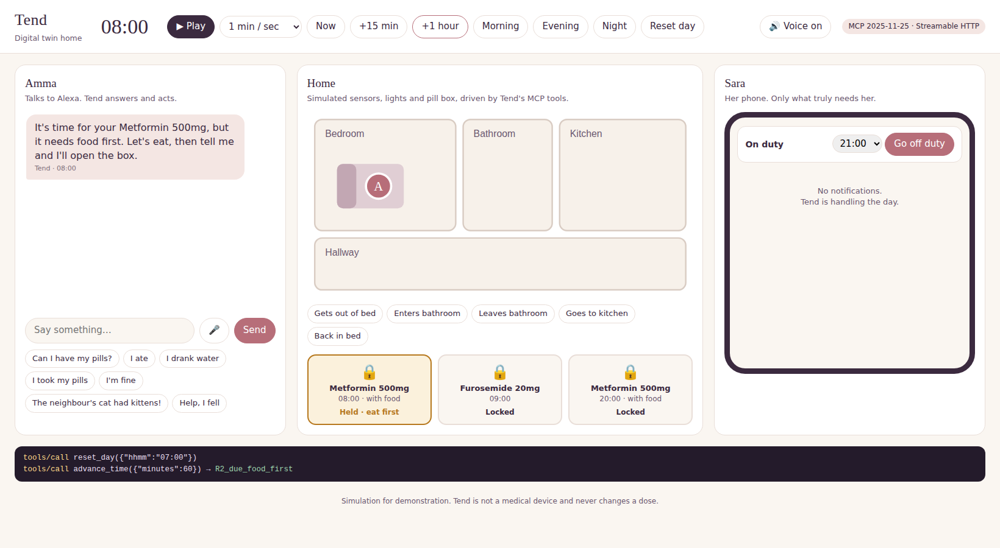
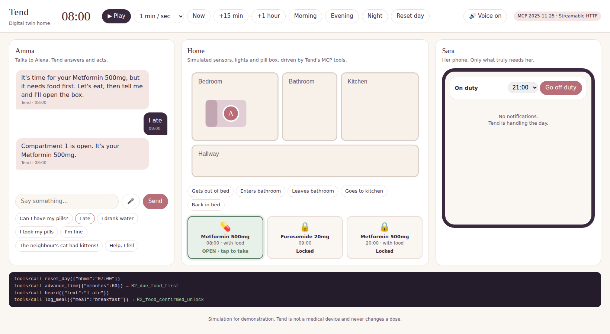
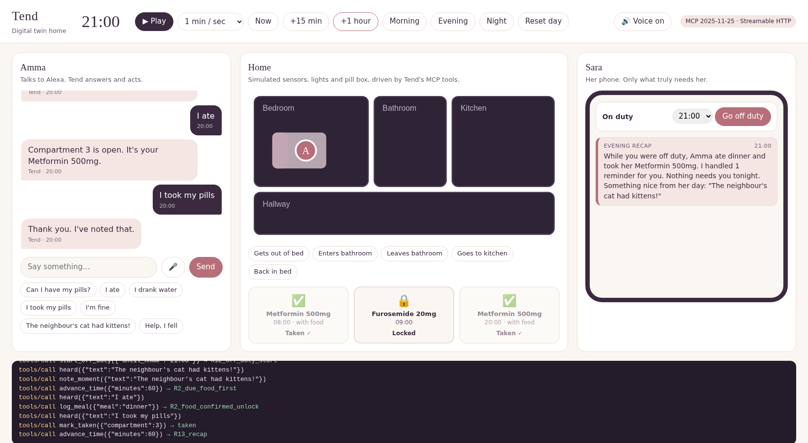
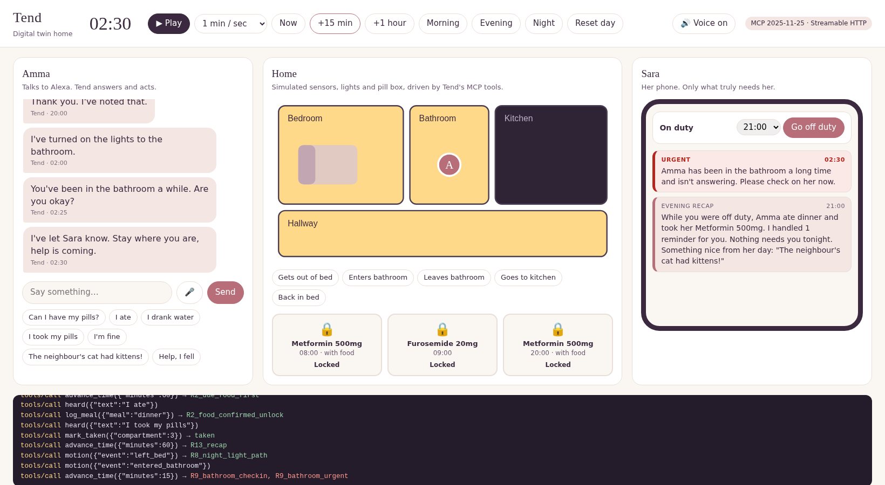
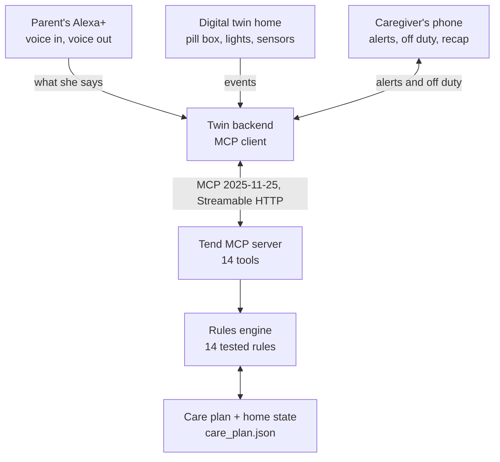

# Tend

**An Alexa+ agent that runs an elderly parent's day at home, so the working caregiver gets her evenings back.**


> Built for the **Build, Ship, Shape: Amazon Developer Hackathon** (Alexa+ track). All code was written during the submission period.

---

## Overview

People who care for an aging parent while holding a job spend their evenings on logistics: pills, meals, water, the bathroom, checking in. Smart pill boxes, reminder apps and fall alarms exist, but each works alone, and every one of them is built to watch the parent.

**Tend connects every signal in the home and acts on them together.** It keeps the pill box locked until she has eaten, expects a bathroom trip after a water pill, lights the way at night, and checks in before it alarms anyone. The caregiver taps **Off duty**, and Tend handles the routine silently, holds what can wait, and breaks through only for a real emergency.

The result is a parent who never has to wait for help, and a caregiver whose phone stays quiet unless it matters.

**Tend is not a medical device.** The care plan is the source of truth. Tend never changes a dose; it only sequences around rules the caregiver sets.

---

## Features

**For the parent (voice-first, through Alexa+)**

- **Pills at the right time, not before.** Each compartment unlocks only in its time window. Outside it, the box stays locked and Tend says when it opens next.
- **Food-first doses.** A pill marked "with food" is held until a meal is confirmed, then unlocks on its own.
- **Cross-signal reminders.** A water pill triggers a bathroom reminder 40 minutes later. Water reminders taper off in the evening so sleep isn't broken.
- **Night light path.** Getting out of bed at night lights the bedroom, hallway and bathroom, and turns them off when she is back in bed.
- **Check in before alarming.** Unopened pills, a long bathroom visit or a silent morning lead to a gentle voice check-in first.

**For the caregiver**

- **Off duty mode.** Routine events are handled silently, non-urgent problems are held, urgent ones always get through.
- **Missed-dose alert.** An offered dose that isn't taken relocks the box and is reported.
- **One recap, not a list of chores.** When off duty ends: what she ate and took, what still needs attention, and one nice moment from her day.
- **Urgent words never wait.** "Help", "I fell" or "chest pain" alert the caregiver immediately, off duty or not.

**For developers**

- **A real MCP server** with 14 tools over Streamable HTTP (spec 2025-11-25).
- **A deterministic rules engine**, with every rule covered by tests. No LLM in the safety path.
- **A digital twin home** that makes every MCP call visible as it happens.

---

## Tech Stack

| Layer | Technology |
|---|---|
| Agent protocol | Model Context Protocol, spec **2025-11-25**, Streamable HTTP |
| MCP server | Python, official MCP Python SDK (`mcp>=1.30,<2`) |
| Rules engine | Pure Python, dataclasses, simulated clock |
| Twin backend (MCP client) | Starlette + Uvicorn |
| Twin front end | HTML, CSS, vanilla JavaScript, inline SVG |
| Voice | Web Speech API (speech recognition + synthesis) |
| Tests | pytest (41 tests) |

---

## Screenshots

**Morning: pills are due, but she hasn't eaten. The box stays locked.**



**She says "I ate". The compartment unlocks on its own.**



**Evening: the caregiver was off duty. She gets one recap.**



**Night: lights guide her to the bathroom. No reply to the check-in, so the alert breaks through.**



> **Demo video:** `[link to be added]`

---

## Architecture



Every button press and every sentence in the twin becomes a real MCP tool call. The server passes it to the rules engine, which reads the care plan and the home state and returns one decision: unlock, keep locked, remind, light, or escalate.

Because Alexa+ speaks MCP, the same server can drive real Alexa-compatible devices in place of the simulated ones.

### The rules

| # | Situation | What Tend does | Severity |
|---|---|---|---|
| 1 | Dose is due, no food rule | Unlocks that compartment only | Routine |
| 2 | Dose is due, "with food", no meal yet | Keeps it locked, unlocks when she has eaten | Routine |
| 3 | Pills requested outside any window | Stays locked, says when it opens next | Routine |
| 4 | Unlocked but not opened in 20 min | Voice check-in, then tells the caregiver | Escalate |
| 5 | Diuretic taken | Bathroom reminder 40 min later | Routine |
| 6 | 2 hours without water (day) | Water reminder; fewer in the evening, none at night | Routine |
| 7 | Mealtime passed, no meal | One meal reminder | Routine |
| 8 | Out of bed at night | Lights a path to the bathroom | Routine |
| 9 | In the bathroom over 25 min | Voice check-in, then an urgent alert | Urgent |
| 10 | No sign of activity in the morning | Voice check-in, then an urgent alert | Urgent |
| 11 | "Help", "I fell", "chest pain" | Urgent alert at once | Urgent |
| 12 | Caregiver off duty | Routine silent, escalations held, urgent breaks through | Mode |
| 13 | Off duty ends | One recap | Recap |
| 14 | Offered dose not taken in its window | Relocks the box, tells the caregiver | Escalate |

Every timing lives in `care_plan.json`, not in code.

---

## Installation

Requires Python 3.11 or newer. Tested on Windows 11 with Python 3.14.

```powershell
git clone https://github.com/fsafva13-coder/tend.git
cd tend
python -m venv .venv
.venv\Scripts\activate          # macOS/Linux: source .venv/bin/activate
python -m pip install -r requirements.txt
```

Check that everything works:

```powershell
python -m pytest -v             # 41 passed
```

---

## Usage

Tend runs as two small programs. Use two terminals, both with the virtual environment activated.

**Terminal 1: the MCP server**

```powershell
python server.py                # http://127.0.0.1:8000/mcp
```

**Terminal 2: the digital twin**

```powershell
python twin/app.py              # then open http://127.0.0.1:8080
```

Open the page in Chrome or Edge (needed for voice).

### A two-minute walkthrough

1. Press **Play**. At 08:00 Tend offers the morning pills but holds them: she must eat first.
2. Say or tap **I ate**. Compartment 1 unlocks. Tap it to take the pills.
3. **Evening** → **Go off duty** → **The neighbour's cat had kittens!** → **+1 hour** → **I ate** → tap the compartment → **+1 hour**. The caregiver gets one calm recap.
4. **Reset day** and repeat step 3 without eating. The dose is missed, the box relocks, and the caregiver is told.
5. **Night** → **Gets out of bed** → **Enters bathroom** → **+15 min** twice. The lights come on, Tend checks in, and the urgent alert breaks through.

### Calling the tools directly

```powershell
npx @modelcontextprotocol/inspector
```

Connect with **Streamable HTTP** to `http://127.0.0.1:8000/mcp`.

| Tool | Purpose |
|---|---|
| `get_home_state` | Clock, pill box, lights, caregiver inbox |
| `request_pills` | Parent asks for her pills |
| `log_meal`, `log_water` | Record a meal or a drink |
| `mark_taken` | Pills removed from a compartment |
| `motion` | Bed and bathroom sensor events |
| `heard` | Anything the parent says; urgent words alert at once |
| `patient_replied` | Answer to a check-in |
| `note_moment` | Save a nice moment for the recap |
| `start_off_duty` | Caregiver goes off duty until a time |
| `get_caregiver_inbox` | Alerts, recaps and held items |
| `advance_time`, `set_time`, `reset_day` | Demo clock controls |

---

## Project Structure

```
tend/
├── server.py                  # MCP server: 14 tools over Streamable HTTP
├── care_plan.json             # Medications, meal times and every threshold
├── tend/
│   └── engine.py              # Rules engine, home state, simulated clock
├── twin/
│   ├── app.py                 # Twin backend: an MCP client + intent parser
│   └── index.html             # Digital twin home (floor plan, pill box, phone)
├── tests/
│   ├── test_pillbox.py        # Rules 1-3
│   ├── test_daily_rules.py    # Rules 4-8
│   └── test_safety_and_off_duty.py   # Rules 9-14, recap, day rollover
├── docs/screenshots/
├── FRICTION_LOG.md            # Developer-experience notes for the hackathon
├── requirements.txt
└── LICENSE
```

---

## Results

| Measure | Value |
|---|---|
| Rules implemented | 14 |
| Automated tests | 41, all passing |
| MCP tools | 14 |
| MCP protocol negotiated | 2025-11-25 over Streamable HTTP |
| External services required | None; runs fully on one laptop |
| Cost to run | Zero |

In the walkthrough above, a calm evening produces **one** notification for the caregiver (the recap) while Tend handles the reminders itself. Urgent words reach her at once, even when she is off duty.

---

## Challenges & Learnings

- **Overlapping dose windows.** At exactly 09:00 the 08:00 window and the 09:00 window are both open. Tend offers one dose at a time and holds the later one until the earlier is resolved, which is the safe order.
- **A recap that sounded fine when it wasn't.** An early version said "a quiet evening" while dinner and a dose were still outstanding. The recap now lists anything still open under "Needs you" before it says anything reassuring.
- **Silent missed doses.** At first the box only opened when asked, so a dose nobody requested simply vanished. Tend now offers each dose at its time and reports any that are missed.
- **Time jumps in a demo.** Skipping the clock forward produced stale reminders ("have you had lunch?" at 19:00). Reminders now expire, and a dose is only reported as missed if Tend actually offered it.
- **MCP SDK versions.** `pip install mcp` installs 2.x, where `FastMCP` was renamed and a newer protocol is negotiated. Pinning `mcp>=1.30,<2` gives exactly spec 2025-11-25. See `FRICTION_LOG.md`.
- **"Ate" versus "eight".** Browser speech recognition returned "8" for "I ate". The twin now reads several recognition candidates and picks the one that makes sense.

---

## Future Improvements

- Replace the keyword intent parser with an LLM, keeping the rules engine as the only decision-maker.
- Smarter urgent-word detection: "that was helpful" currently matches "help". A false alarm is the safer failure, but it should be rare.
- Real devices: Alexa-compatible smart lock pill dispenser, lights and motion sensors in place of the simulation.
- A week view for the caregiver: adherence, sleep interruptions, alerts and interruptions avoided.
- Several caregivers with a handover between them.
- Caregiver-editable care plan in the app instead of a JSON file.

---

## Demo

- **Video:** `[link to be added]`
- **Run it yourself:** follow [Installation](#installation) and [Usage](#usage); it takes about two minutes.

---

## License

MIT. See [LICENSE](LICENSE).

Built by [Fathima Safva](https://github.com/fsafva13-coder).
